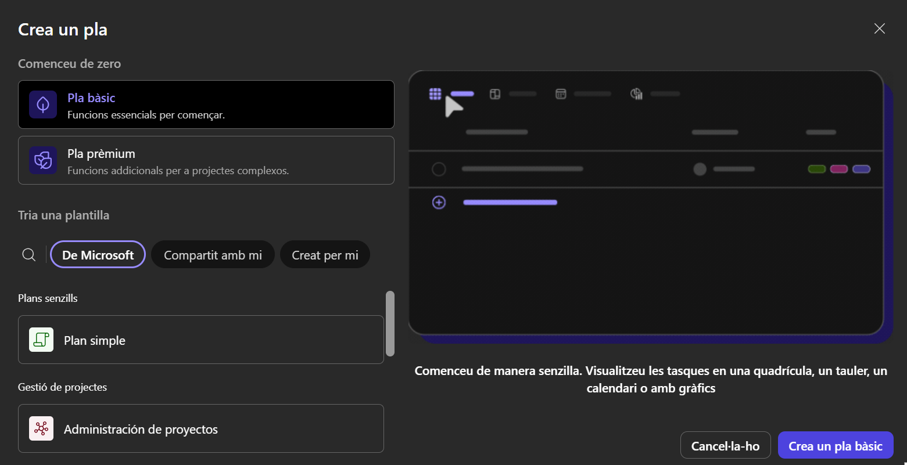
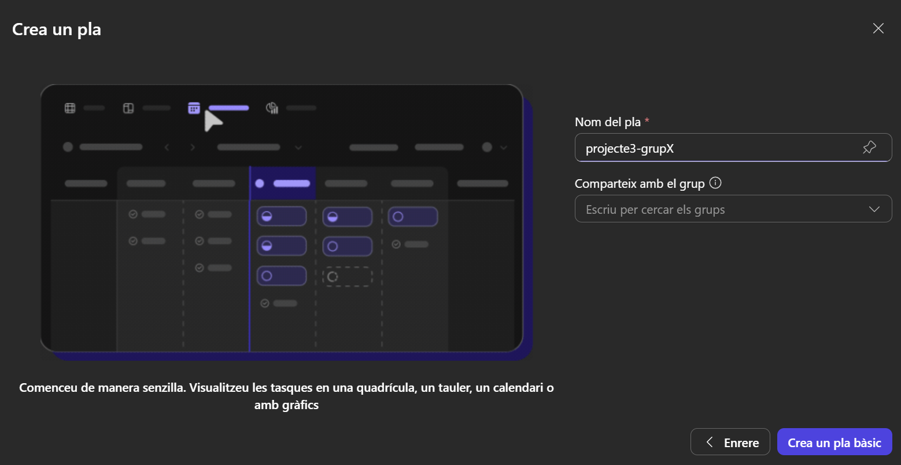
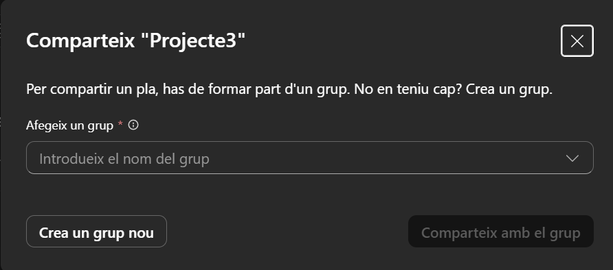
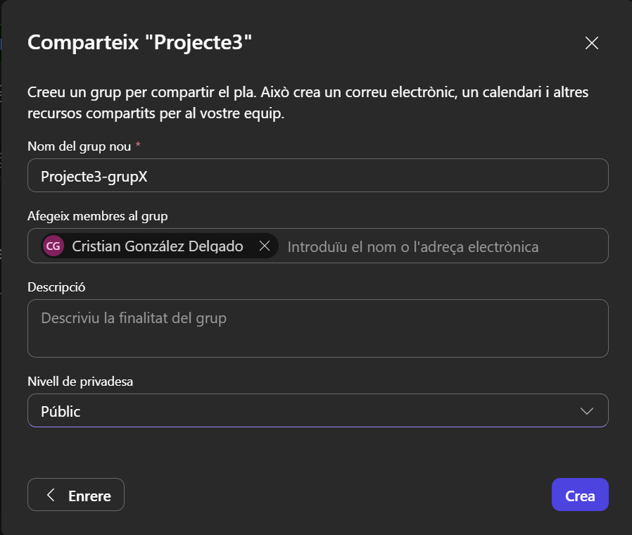
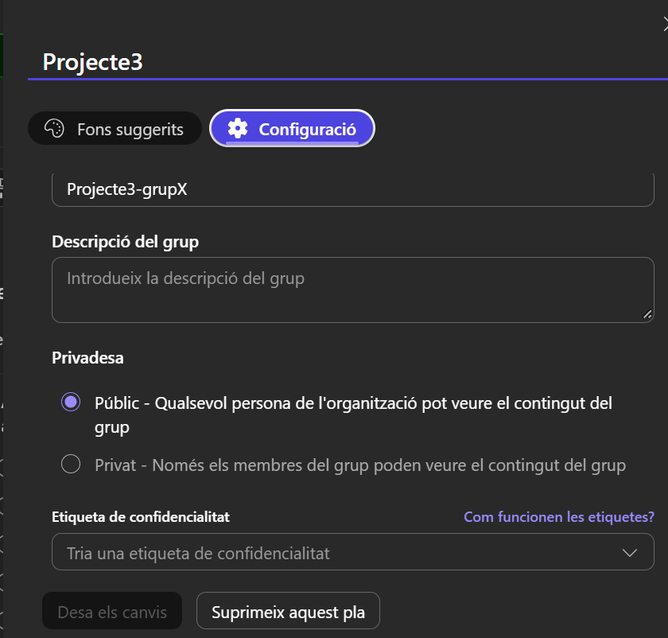

# Guia 2:Crear projectes amb Microsoft Planner

En aquesta guia veurem com crear un projecte amb Microsoft Planner per usar la metodologia Kanban, per tal que els membres del grup hi puguin treballar en ell i que sigui visible per a tothom, per tal que el professorat pugui fer un seguiment de l'evolució del projecte.

## Crear un projecte amb Microsoft Planner

### Requisits previs

Heu de tenir un compte de Microsoft 365 i per accedir al Planner amb el compte de l'escola.

### 1. Crear un projecte amb Microsoft Planner

1. Obriu el navegador web i aneu a la pàgina de [Microsoft Planner](https://planner.cloud.microsoft/ui/web/) per accedir directment o des del portal de Microsoft 365, aneu a "Aplicacions" i seleccioneu "Planner".

2. Crear un nou pla: Un cop dins de Planner, feu clic a "Nou pla" per crear un nou projecte. Trieu el pla gratuït i trieu el pla senz
    

3. Assigneu un nom al vostre projecte.
    

**Important!:** Quan treballeu en equips, **només un dels membres** del grup ha de crear el projecte.

## Assignar el projecte a un grup i fer públic

1. Ja el teniu creat, ara toca assignar-lo a un grup. Per fer-ho aneu a "Compartir" i el podeu assignar a un grup existent, o el que serà el més habitual, crear un grup nou.
    

2. Al grup nou, li definiu un nom i afegiu la resta de membres del grup. Un cop creat el grup, ja podreu començar a treballar amb el vostre projecte.
    

3. Un cop creat el grup, ja podreu començar a treballar amb el vostre projecte, queda només fer-lo públic, per tal que les persones a les que compartiu l'enllaç (per exemple, els professors de projecte) puguin veure'l.
    
