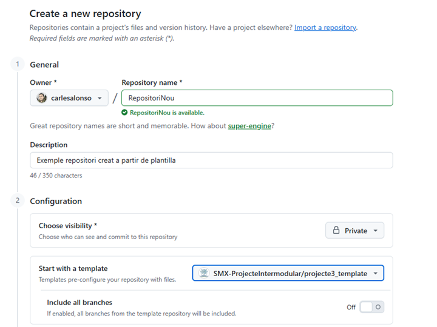
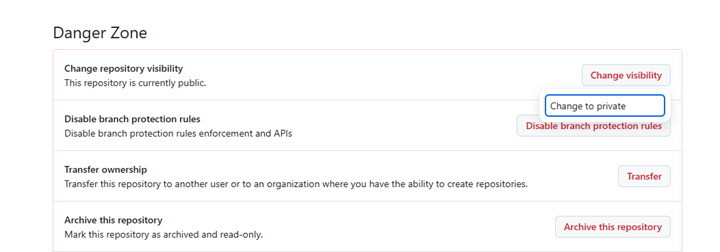
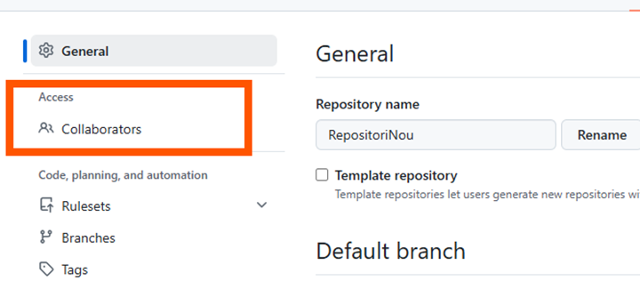
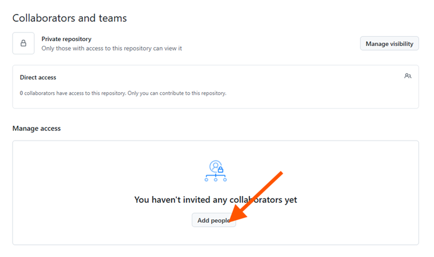
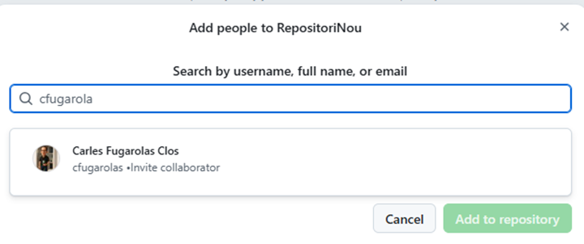
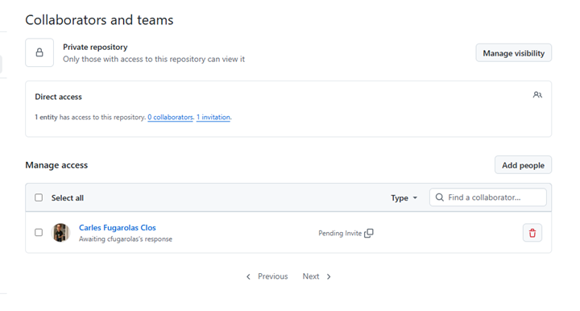

# Guia 4: Creació de repositoris a partir de plantilla

Aquesta guia explica com crear un repositori nou a GitHub a partir d'una plantilla (*template*) i com configurar-lo perquè sigui **privat**.

## Accedir al formulari de nou repositori

1. Inicia sessió a [GitHub](https://github.com).
2. A la barra superior, fes clic al botó **+** i selecciona **New repository**.


## Crear el repositori a partir d'una plantilla

Un repositori plantilla és un repositori que conté una estructura de fitxers i carpetes preparada per ser reutilitzada. Crear un repositori a partir d'ella copia aquesta estructura (sense l'historial de commits) al teu compte.

1. A **Owner** assegura't que apareix el teu nom d'usuari o l'organització on vols crear el repositori si pertanys a una. Això serà important en projectes on haureu de crear el repositori dins d'una organització i no al vostre compte personal.

2. Escriu el nom del repositori **Repository Name** que vols crear, per exemple `projecte3` i inclou una descripció a **Description**.

3. A **Choose visibility** selecciona **Private** si vols que el repositori sigui privat. Si no, deixa-ho com a **Public**.

4. A **Start with a template** fes clic a **Choose a template** , si tens plantilles pròpies o a les organitzacions on pertanys, les veuràs a la llista. Si no, escriu directament el nom de la plantilla que vols utilitzar, per exemple:

```text
SMX-ProjecteIntermodular/projecte3-template
```



## Canviar la visibilitat d'un repositori existent

Si ja has creat el repositori com a públic:

1. Ves al repositori i obre **Settings**.
2. Baixa fins a la secció **Danger Zone**.
3. Fes clic a **Change visibility**, selecciona **Change to private** i confirma l'acció.



## Convidar col·laboradors a un repositori privat

En un repositori privat, cal donar accés explícit a cada persona:

1. Ves a **Settings > Collaborators**.
  

2. Fes clic a **Add people**.
  

3. Escriu el nom d'usuari de GitHub o el correu electrònic (ha de ser un correu electrònic registrat a GitHub) de la persona que vols afegir i fes clic a **Add**.
  

4. Un cop afegida, la persona rebrà una notificació per correu electrònic i podrà acceptar la invitació per accedir al repositori privat. Mentre apareixerà la invitació pendent a la llista de col·laboradors.
  
