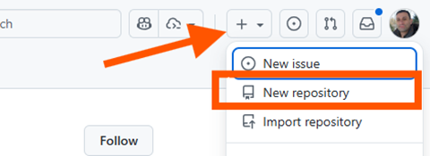

# Guia 4: Creació de repositoris a partir de plantilla

Aquesta guia explica com crear un repositori nou a GitHub a partir d'una plantilla (*template*) i com configurar-lo perquè sigui **privat**.

## Accedir al formulari de nou repositori

1. Inicia sessió a [GitHub](https://github.com).
2. A la barra superior, fes clic al botó **+** i selecciona **New repository**.

## Crear el repositori a partir d'una plantilla

Un repositori plantilla és un repositori que conté una estructura de fitxers i carpetes preparada per ser reutilitzada. Crear un repositori a partir d'ella copia aquesta estructura (sense l'historial de commits) al teu compte.

1. Al formulari **Create a new repository**, desplega el camp **Repository template** (a l'apartat *General*).
2. Selecciona la plantilla desitjada (per exemple, la proporcionada pel professorat a l'organització `SMX-ProjecteIntermodular/projecte3_template`).

    

    > Si no veus la plantilla, comprova que tens accés al repositori que la conté i que aquest està marcat com a *Template repository* (**Settings > Template repository**).

3. Indica l'**Owner** (el teu usuari o una organització) i el **Repository name**. El nom ha de ser curt, descriptiu i sense espais (usa guions, per exemple `projecte-intermodular`).

4. Opcionalment, afegeix una **Description**.

## Especificar la visibilitat: privat

Al mateix formulari, a l'apartat **Choose visibility**, selecciona:

- **Public**: qualsevol persona pot veure el repositori.
- **Private**: només tu i les persones a qui donis accés poden veure'l i col·laborar-hi.

Marca l'opció **Private**.

Finalment, fes clic a **Create repository**. GitHub generarà el repositori amb el contingut de la plantilla i veuràs una icona de **Private** al costat del nom.

## Canviar la visibilitat d'un repositori existent

Si ja has creat el repositori com a públic:

1. Ves al repositori i obre **Settings**.
2. Baixa fins a la secció **Danger Zone**.
3. Fes clic a **Change visibility**, selecciona **Change to private** i confirma l'acció.

## Convidar col·laboradors a un repositori privat

En un repositori privat, cal donar accés explícit a cada persona:

1. Ves a **Settings > Collaborators**.
2. Fes clic a **Add people** i cerca l'usuari pel seu nom d'usuari o correu.
3. L'usuari rebrà una invitació que haurà d'acceptar.
