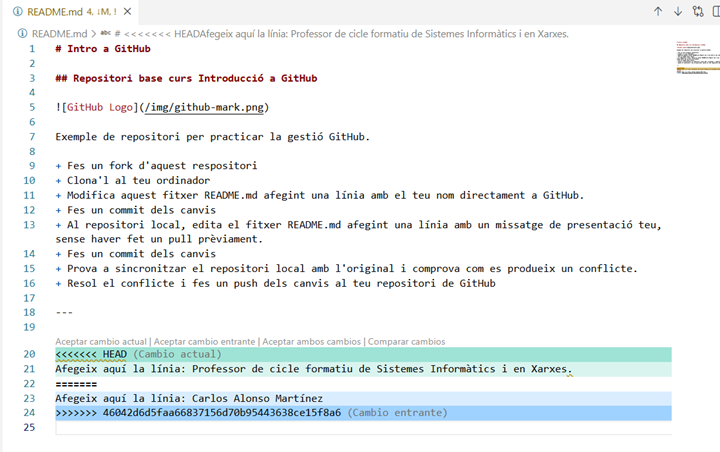

# Guia 5: Resolució de conflictes a GitHub

## Gestió de Conflictes

Un conflicte apareix s'ha editat **la mateixa línia** del mateix fitxer i intentes fusionar els canvis. Git no sap quina versió és la bona i es queda "parat". Un cas habitual és quan es van fer canvis al fitxer que es van pujar a GitHub, i ara has modificat el mateix arxiu, però no has fet Pull abans de començar a treballar, de manera que hi ha dues versions diferents.

### Resolució de conflictes

Si en sincronitzar apareix un conflicte, VS Code és un dels millors editors per resoldre'ls:

Els fitxer en conflicte es marcaran amb colors i indicacions visuals de les línies on es produeix el conflicte, en verd el canvi proposat en local i en blau el canvi rebut del repositori remot.



Dins del fitxer, veureu botons a sobre del text que diuen:

```text
- Accept Current Change: Es queda amb el que tu has escrit.
- Accept Incoming Change: Es queda amb el que ha pujat el company.
- Accept Both Changes: Posa un text sota l'altre.
```

Un cop triat, prem el `+` al panell de control de versions per afegir els canvis al staging area (`add`), fes el commit i després sincronitza els canvis amb GitHub.
