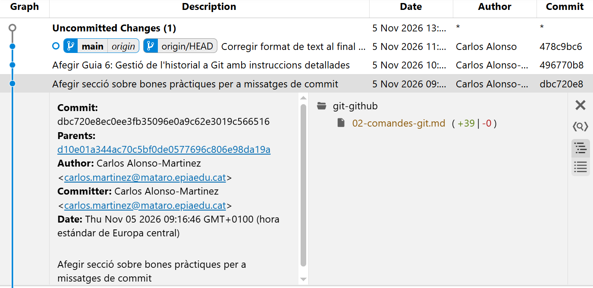
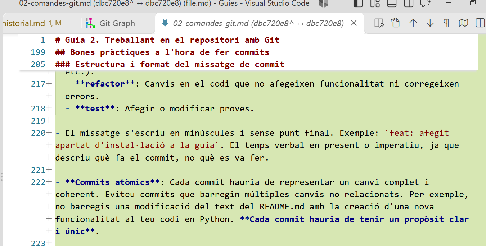

# Guia 6: Gestió de l'historial a Git

> "Who controls the past controls the future. Who controls the present controls the past."
>
> — George Orwell, *Nineteen Eighty-Four* (1949)

## Introducció

## Què és l'historial a Git?

L'historial a Git és un registre de tots els canvis realitzats en un projecte al llarg del temps. Cada vegada que es fa un commit, Git guarda una instantània de l'estat del projecte en aquell moment, permetent als desenvolupadors veure com ha evolucionat el projecte i revertir canvis si és necessari.

Normalment, l'historial avança de manera lineal, i cap endavant, però a vegades, poden aparèixer situacions on cal tornar enrere o explorar versions anteriors del projecte. Git proporciona eines per gestionar aquest historial de manera eficient.

L'historial de commits té una estructura de pila, això vol dir que el commit més recent es troba a la part superior de la pila, i els commits anteriors es troben sota. El darrer commit, ocupa el cim de la pila i es pot referir a ell amb la paraula clau `HEAD`. El commit anterior al darrer, es pot referir amb `HEAD~1`, el commit anterior a aquest amb `HEAD~2`, i així successivament.

Cada commit té un identificador únic (hash) que permet referir-se a ell de manera precisa, no cal escriure tot el hash, amb els primers 7 caràcters és suficient per identificar-lo. Per exemple, el commit amb hash `c313532c8367913ec18b69202d88f23bc15fde38` es pot referir com a `c313532`.

Veurem com realitzar les diferents accions per comandes, que podeu executar des del terminal de Visual Code o directament des del terminal del sistema operatiu, i també com realitzar-les amb l'editor Visual Studio Code, en aquest cas, tenint instal·lada l'extensió `Git Graph`.

## Desfer canvis abans de fer commit

Quan editem, estem treballant en el Working Directory, que és l'espai on es troben els fitxers del projecte. Quan fem `git add`, estem afegint els canvis a l'Index (staging area), que és una zona temporal on es preparen els canvis abans de fer commit.

A vegades ens interessa descartar canvis a la fase d'edició o fins i tot, descartar canvis ja preparats per al commit. Git ens ofereix opcions per fer-ho de manera segura.

### Desfer canvis al Working Directory (abans de fer commit)

Imagina que estàs editant un fitxer de codi i per error, esborres informació crucial o comets una errada de disseny, de manera que vols descartar tots el canvis realitzats. Com que encara no has fet git commit, pots descartar els canvis del Working Directory i tornar el fitxer a l'estat del darrer commit.

Com?

Per comandes (terminal):

```bash
git restore <nom_fitxer>
```

Amb l'editor Visual Studio Code, anant a la secció "Control de codi font", pots fer clic amb el botó dret sobre el fitxer i seleccionar l'opció "Descartar canvis".

Si vols descartar tots els canvis de tots els fitxers, pots utilitzar:

```bash
git restore .
```

O bé, amb Visual Studio Code, anar sobre la secció de "Canvis" dins el control de codi font i fer clic a "Descartar tots els canvis".

Es pot comprovar com un cop fet el `restore`, el Working Directory torna a estat sincronitzat amb l'àrea temporal (staging area) i amb el darrer commit.

## Desfer canvis a l'Index (staging area) abans de fer commit

Si ja hem afegit els canvis a l'Index (staging area) amb `git add`, però encara no hem fet commit, podem desfer aquests canvis i tornar-los al Working Directory.

Per fer-ho, podem utilitzar la comanda:

```bash
git restore --staged <nom_fitxer>
git restore --staged .
```

O bé, amb Visual Studio Code, anar a la secció "Control de codi font", a "Canvis (staged)" i allà cancel·lar l'emmagatzematge provisional. Es pot fer individualment per un fitxer (símbol `-` al costat del fitxer) o bé cancel·lar tots els fitxers alhora, amb el `-` al costat de "Canvis (staged)".

## Retrocedint a l'historial (viatge en el temps)

Què passa quan l'error ja s'ha guardat en un o diversos commits? Com podem retrocedir en el temps?

A Git no hi ha una sola manera de fer-ho; existeixen tres estratègies principals, cadascuna amb els seus avantatges, inconvenients i casos d'ús.

### Canviant el passat (git reset)

Aquesta opció permet eliminar commits de l'historial i tornar el projecte a un estat anterior. És una opció que s'ha de utilitzar amb precaució, ja que pot causar pèrdua de dades si no s'utilitza correctament com es comenta al final d'aquesta secció.

Existeixen tres tipus de `git reset`:

- `--soft`: Retorna al commit indicat, sense canviar ni el Working Directory ni l'Index (Staging Area). De manera que allà tenim encara la versió més nova dels fitxers, a punt per fer un nou commit.
- `--mixed` (per defecte): Retorna al commit indicat. Els canvis dels commits posteriors es queden a la carpeta de treball (Working Directory) però **no al staging area**. És a dir, els canvis es poden tornar a preparar per al commit fent el "Emmagatzemar els canvis" o per comandes `git add .`.
- `--hard`:DESTRUCTIU. Esborra tots els commits posteriors I TOTS els canvis de la carpeta de treball. És ad dir, Working Directory i Staging Area tornen a l'estat del commit indicat. Per tant, **es perden tots els canvis posteriors**.

Per comandes (terminal), primer identificarem el hash del commit al qual volem tornar. Per exemple, si volem tornar al commit amb hash `c313532c8367913ec18b69202d88f23bc15fde38`, podem utilitzar segons el tipus de reset que vulguem fer:

```bash
git reset --soft c313532
git reset c313532
git reset --hard c313532
```

Des de Visual Code, cal seguir la següent seqüència d'accions:

1. Obre el panell de Control de Font: Fes clic sobre l'icona de Git al menú lateral esquerre o prem la drecera Ctrl + Shift + G (o Cmd + Shift + G a Mac).

1. Desplega la Línia de Temps (Timeline): A la part inferior del panell lateral o de l'explorador de fitxers, cerca la secció anomenada Timeline (Línia de temps). Hi veuràs la llista cronològica de tots els teus commits.

1. Selecciona el commit d'destinació: Fes clic dret sobre el commit "feat: afegeix servidor DNS primari".

1. Tria l'opció de Reset: Al menú desplegable, selecciona "Reset current branch to this commit..." (Reiniciar la branca actual a aquest commit...).

1. Escull el mode de Reset: VS Code et demanarà quin tipus de reset vols aplicar:
    - Tria `Hard` si vols esborrar els canvis posteriors del tot (equivalent a git reset --hard).
    - Tria `Soft` si vols conservar les modificacions a la zona de preparació.
    - Tria `Mixed` si vols conservar les modificacions com a canvis pendents sense preparar.

Si simplement volem eliminar el **darrer commit**, sense afectar commits anteriors, , pots anar al panell de Control de Font, fer clic a la icona dels tres punts (...) a la part superior dreta del panell > Commit > Undo Last Commit (Desfer l'últim commit). Això equival a un `git reset --soft HEAD~1`.

Per exemple, sobre un repositori mirem l'historial amb `git log` i veiem que té 3 commits:

```log
commit c313532c8367913ec18b69202d88f23bc15fde38
Author: John Doe <john.doe@example.com>
Date:   Mon Jan 1 00:00:00 2024 +0000

    feat: afegeix servidor DNS primari

commit a1b2c3d4e5f6g7h8i9j0k1l2m3n4o5p6q7r8s9t0
Author: John Doe <john.doe@example.com>
Date:   Sun Dec 31 00:00:00 2023 +0000

    fix: correcció de bug en el servidor

ommit b2c3d4e5f6g7h8i9j0k1l2m3n4o5p6q7r8s9t0u1
Author: John Doe <john.doe@example.com>
Date:   Sat Dcec 30 00:00:00 2023 +0000

    docs: actualització de la documentació
```

Si apliquem un `reset` al commit més antic, `b2c3d4e5f6g7h8i9j0k1l2m3n4o5p6q7r8s9t0u1`, i torno a mirar l'historial, ara veurem quelcom com això:

```log

commit b2c3d4e5f6g7h8i9j0k1l2m3n4o5p6q7r8s9t0u1
Author: John Doe <john.doe@example.com>
Date:   Sat Dcec 30 00:00:00 2023 +0000
    docs: actualització de la documentació
```

És a dir, els **commits posteriors han desaparegut de l'historial**.

> ⚠️ **ALERTA** : Aquesta opció esborra o desplaça commits de l'historial. **Només s'ha d'utilitzar en el teu entorn local per modificar un historial abans de pujar-lo a GitHub**. Per què? Tot i que pots pensar que és una solució molt elegant perquè amaga allò que no vols que es vegi, si ja has pujat els canvis a GitHub, altres persones o tu mateix en una altra còpia local del repositori, per exemple a casa, podeu haver fet pull i tenir aquests commits en el seu historial. Si després fas un push amb `git reset`, estaràs reescrivint l'historial i això pot causar problemes de sincronització amb els repositoris remots.

### Inversió segura dels canvis (git revert)

És l'estratègia més segura i la recomanada per treballar habitualment i **obligatòria** en entorns col·laboratius. Crea un **NOU commit** que recupera exactament els canvis d'un commit passat. És a dir, no esborrem la història, sinó que és com tornar al present un instant del passat, sense esborrar cap commit.

Com funciona un `git revert`?

- Inspecció del commit d'origen: Git analitza el commit que vols anul·lar i en treu la fotografia exacta de quines línies es van afegir (+) i quines es van esborrar (-).
- Càlcul de la inversió: Inverteix la lògica del canvi:
  - Les línies que es van afegir en aquell commit, ara s'eliminen.
  - Les línies que es van eliminar en aquell commit, ara es tornen a escriure.
- Fusió amb l'estat actual (HEAD): Aplica aquesta inversió a la teva carpeta de treball (Working Directory) i a la zona de preparació (Staging Area).
- Generació d'un nou commit: Crea un nou commit a la línia temporal que deixa constància explícita que s'ha corregit o anul·lat aquell commit antic.

De forma pràctica, si volem revertir el commit amb hash `c313532c8367913ec18b69202d88f23bc15fde38`, podem utilitzar la comanda:

```bash
git revert c313532
```

Si fos el darrer commit, també podem utilitzar:

```bash
git revert HEAD
```

En el cas de Visual Code anat a `git graph`, podem fer clic amb el botó dret sobre el commit que volem revertir i seleccionar l'opció "Revert Commit". Això crearà un nou commit que desfà els canvis del commit seleccionat.

**Gestió de conflictes en fer un Revert**:

Si intentes revertir un commit antic que modifica línies de codi que has canviat posteriorment, VS Code et mostrarà un conflicte de fusió (Merge Conflict).

A l'editor veuràs les opcions en color blau i verd (Accept Current Change / Accept Incoming Change).

Només cal que triïs quina versió de la configuració vols mantenir, desis el fitxer, el moguis a la zona de preparació amb la icona + (Stage Changes) i facis clic a Commit.

### Exploració Temporal (Detached HEAD)

S'utilitza quan vols consultar o provar l'estat del projecte en el passat sense esborrar res ni modificar la història oficial.

Es basa a crear un estat temporal on el `HEAD` apunta a un commit antic, però no es modifica l'historial. És útil per fer proves o inspeccionar versions anteriors del projecte sense afectar la línia principal de desenvolupament. **No serveix per modificar el contigut del commit explorat**.

Com provar-ho?

1. Identifica el commit que vols explorar amb `git log` o amb l'eina gràfica i copia el seu hash.

1. Per terminal executem:

   ```bash
   git switch --detach <hash_del_commit>
   ```

1. A l'editor ens apareixerà la versió antiga dels arxius. Podem navegar pel projecte, executar proves, però no podem fer commits en aquest estat.

1. Per tornar a l'estat normal, simplement fem:

   ```bash
   git switch main
   ```

Usant Visual Code, anem a la secció de Control de Codi Font, i cliquem sobre l'opció de "git graph". Veurem com ens apareix el gràfic amb tots els commits.

Si cliquem sobre un commit, ens apareix la informació i a la dreta l'opció d'Explorar (la lupa).



Se'ns obre a l'editor una nova pestanya amb l'estat dels arxius en aquell commit.



### Comparativa ràpida entre mètodes

| Característica | `git revert` | `git reset` |
| --- | --- | --- |
| Acció sobre l'historial | Afegeix un nou commit al capdavant (Avança). | Desplaça el punter HEAD enrere (Elimina commits). |
| Seguretat | 100% Segur. No modifica la història passada. | Perillós. Reescriu la història i esborra registres. |
| Ús en equips (GitHub) | Recomanat. No genera conflictes amb altres companys. | Prohibit en branques compartides (main/develop). |
| Traçabilitat / Auditoria | Manté l'error i la correcció registrats. | Esborra qualsevol rastre que l'error hagi hagut mai. |

## Comparant canvis entre commits

Per comparar les diferències entre dos punts qualsevol de l'historial, pots utilitzar comandes directes des de la terminal o visualitzar-ho gràficament amb l'extensió Git Graph a Visual Studio Code.

### Opció 1: Comparació des de la Terminal (git diff)

La comanda `git diff` permet comparar fitxers entre diferents commits de l'historial.

- Comparar dos commits complets:

    Identifica els hashes dels dos commits que vols comparar a través de `git log --oneline` i executa:

    ```bash
    git diff <hash_antic> <hash_recent>
    ```

  - Línies en vermell amb un -: Línies que existien al commit antic però han estat eliminades o modificades.
  - Línies en verd amb un +: Línies noves afegides al commit recent.

- Comparar un fitxer concret entre dos commits:

  Si només vols veure els canvis del fitxer help.txt:

  ```bash
  git diff <hash_antic> <hash_recent> -- help.txt
  ```

- Comparar l'últim commit amb el penúltim:

  Pots utilitzar la referència HEAD~1 (el commit immediatament anterior):

  ```bash
  git diff HEAD~1 HEAD
  ```

### Opció 2: Comparació visual amb l'extensió Git Graph a Visual Studio Code

L'extensió Git Graph transforma l'historial de Git en un arbre visual interactiu ideal per analitzar repositoris complexos.

1. Obre el visualitzador: A la barra d'estat inferior de VS Code o a la part superior del panell de Control de Font (Ctrl + Shift + G), fes clic a la icona o text Git Graph. S'obrirà un graella amb tot l'arbre de commits.

1. Selecciona el primer commit (Commit A): Fes clic dret sobre el commit antic que vols utilitzar com a referència i tria "Select Commit A".

1. Selecciona el segon commit (Commit B): Fes clic dret sobre el commit recent amb el qual el vols comparar i tria "Compare with Commit A".

1. Revisa els fitxers modificats: A la part inferior o lateral de la finestra es desplegarà una llista amb tots els fitxers que tenen diferències entre aquells dos moments.

1. Vista en paral·lel (Side-by-Side Diff): Fes clic sobre qualsevol fitxer de la llista (per exemple, interficies.txt). VS Code t'obrirà l'editor dividit en dues columnes: a l'esquerra veuràs el contingut original i a la dreta el contingut modificat, destacant els canvis línia per línia en vermell i verd.

> 💡 **Consell**: Quan hagis d'explicar un canvi de configuració a un client o a un company d'equip, utilitza la vista comparativa en paral·lel de Git Graph per capturar una imatge clara del abans i el després.